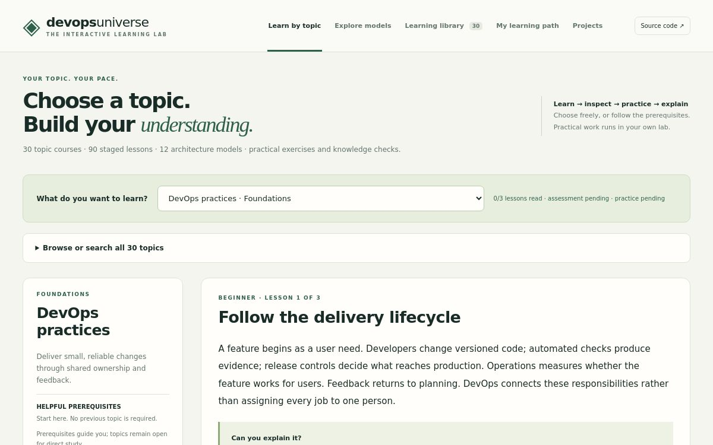
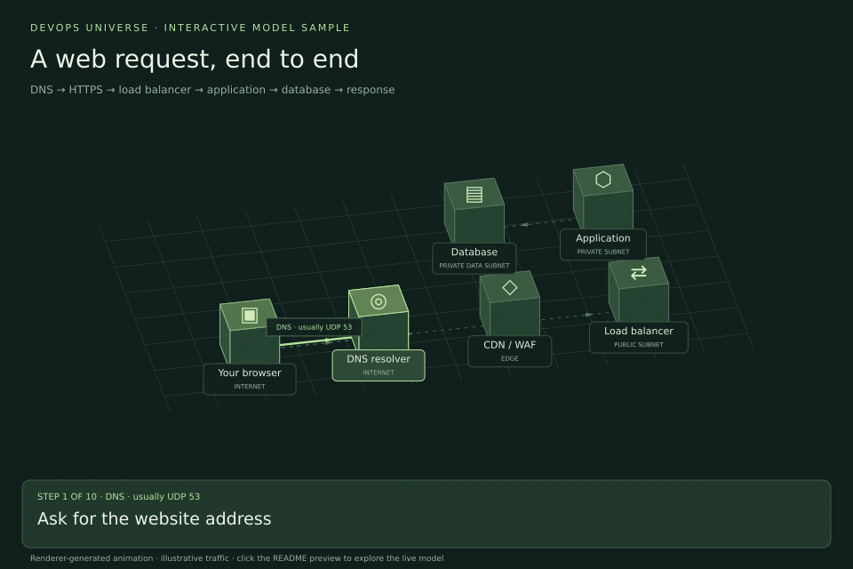
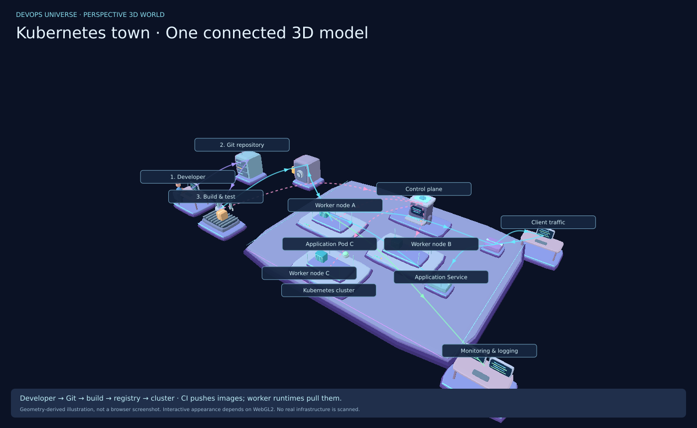
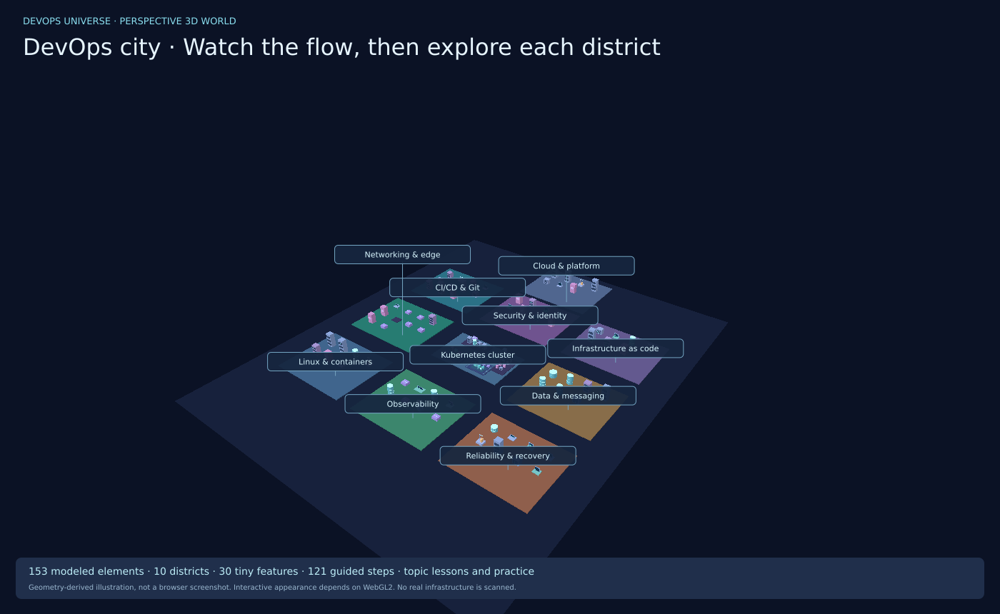

# DevOps Universe 3D

**Choose a topic. Follow the flow. Practice and explain it.**

A free, topic-first DevOps learning website with staged lessons, inspectable architecture models, practical exercises, troubleshooting cases and guided projects. No API key, paid AI model or cloud account is needed to use the site.

## Live site preview

[](https://devops-universe-3d.vishnukushwaha63.chatgpt.site)

*Actual screenshot of the deployed topic-learning homepage, captured 18 October 2026. The live site requires owner access.*

## 3D model sample

[](https://devops-universe-3d.vishnukushwaha63.chatgpt.site/?model=web)

**[Explore this model live →](https://devops-universe-3d.vishnukushwaha63.chatgpt.site/?model=web)**

*Animated preview generated from the website’s model renderer and lesson data, not a browser recording. Click to rotate, zoom, inspect connections and follow each step on the live site. GitHub renders the preview; it does not embed the interactive website. Live-site owner access is required.*

## Start

```bash
git clone https://github.com/Vishnu063/devops-universe-3d.git
cd devops-universe-3d
python3 -m http.server 8080 --directory dist
```

Open **http://localhost:8080**. No npm installation is required. Use an HTTP server; JavaScript modules may not load correctly from a `file://` URL.

The separate owner-private hosted site is [DevOps Universe 3D](https://devops-universe-3d.vishnukushwaha63.chatgpt.site). Repository pushes do not automatically update that hosted copy.

## Kubernetes: explore the connected model (v1.5)

**[Open the existing Kubernetes view →](https://devops-universe-3d.vishnukushwaha63.chatgpt.site/?world=kubernetes)** (owner-private)

[](https://devops-universe-3d.vishnukushwaha63.chatgpt.site/?world=kubernetes)

*Illustration generated from the actual mesh geometry and model relationships, not a browser screenshot. Browser shading, label layout and touch/device performance remain unverified.*

The same Kubernetes workspace and canvas now open on a connected architecture model. No extra website tab or page was added. The design follows the supplied illustration’s visual organization with rounded layered platforms, a control-plane tower, three worker/Pod/container groups, a developer workstation, Git server, robotic build station, registry vault, entry routing and monitoring desk. The procedural models are an approximation of the illustration, not an exact reproduction of its rendered artwork.

- **One model first:** the component browser and inspector stay folded until requested; connection details and the retained guided explanations are below the scene in a closed panel.
- **Recognizable boundaries:** worker platforms contain Pod groups and corrugated app containers. Control-plane internals reveal when you approach or inspect them. Small configuration chips remain small.
- **Directed connections:** CI pushes images; worker runtimes request pulls and the registry returns image layers. Cluster control, user traffic, build events and telemetry have separate colors and labels. Select a connection to read its abbreviated boundaries.
- **Motion controls:** animated beads show illustrative network exchanges, with a pause switch and reduced-motion support. This is modeled traffic, not a live infrastructure scan.
- **Connection filters:** show all connections, image transfers, application traffic, code/build, control activity or telemetry.
- **Same navigation:** horizontal/vertical rotation, pan, zoom, reset and full screen remain. Components opens the searchable catalog; selecting an object opens its inspector. Explore city and the other existing districts remain available.

The third worker is an example, not a required Kubernetes minimum. Control arrows summarize API-mediated scheduling/reconciliation. Service references are logical routing abstractions; the control plane does not forward ordinary application HTTP. Collectors, public DNS, external load balancers and image pulls on other workers are abbreviated in this overview; existing detailed explanations remain available.

## Optional Kubernetes guided explanations (v1.4 content)

**[Start the Kubernetes lessons →](https://devops-universe-3d.vishnukushwaha63.chatgpt.site/?world=kubernetes)** (owner-private)

The optional guided mode starts with **only a node, a Pod and an app container**. Other towns and unrelated Kubernetes components stay hidden. Choose **Watch**, pause, move one step at a time or inspect an object. Small lesson layouts keep the relevant objects together. Camera controls and teaching buttons remain available in full screen.

Seven focused lessons add **26 explained steps**:

1. Node → Pod → container: where the app runs.
2. Deployment → ReplicaSet → Pods: ownership and replica intent.
3. Client → Ingress → Service/Pod → response: application traffic.
4. ConfigMap, Secret and environment: configuration references.
5. Claims, provisioning and mounts: storage and persistence caveats.
6. Startup, readiness, liveness and resource limits: health and symptoms.
7. API, controllers, scheduler, kubelet and runtime: a new Pod’s startup.

The first lesson is a containment view, not a packet trace. In these focused lessons, logical relationships use static dashed arrows. Network exchanges use cyan paths and moving particles during playback; control activity uses pink. Each lesson explains its abbreviated boundaries and what the arrow means. Detailed explanations sit outside the canvas, not over the model.

**Entire K8s town** opens the full modeled Kubernetes area. **Explore city** restores the existing connected towns. Lesson steps keep their focused component set rather than reopening the city. The existing city content remains available.

Example manifests and status/log notes are labeled illustrative. The image registry/name in these manifests is a placeholder requiring a real lab image and its configuration. Nothing is applied to a real cluster. Knowledge checks and the existing troubleshooting exercises are optional. This introduction is not an exhaustive Kubernetes course or proof of hands-on competence.

Design reference: [rohitg00/k8sgames](https://github.com/rohitg00/k8sgames) inspired distinct resource shapes, separate relationship types and focused lessons. No source code or assets from that repository were copied into this update.

## Explore the DevOps city (v1.3.1)

**[Enter the DevOps city →](https://devops-universe-3d.vishnukushwaha63.chatgpt.site/?world=city)** (owner-private hosted site; the older `?world=kubernetes` link still opens the world)

[](https://devops-universe-3d.vishnukushwaha63.chatgpt.site/?world=city)

*Illustration rendered from the actual Three.js meshes, not a browser screenshot. Browser/WebGL appearance, label placement and phone performance remain unverified.*

The workspace starts with the connected Kubernetes model. Use **Explore city**, then **Complete city** for the whole architecture, or choose another district. Start with **code to production & feedback**, press **Watch flow**, pause, inspect a destination, and replay as needed. Selecting a district selects its related journey. The scene’s **Flow controls** panel starts collapsed so it does not cover the model; expand it only when needed. Use **Full screen** for a canvas-first view, and the same button or Escape to exit. A page-filling fallback is provided when native full screen is unavailable. Playing a connected journey reopens the whole city so its dependencies stay visible.

- **177 modeled elements**, including **30 small configuration features**, across **11 districts**: Git/collaboration, delivery, Kubernetes, security, infrastructure as code, networking, AWS/cloud, Linux/containers, data/messaging, observability and reliability/recovery.
- **23 architecture journeys / 181 explained steps**: the four existing Kubernetes journeys plus release/feedback, network/return paths, infrastructure changes, telemetry, asynchronous work, recovery, security, container lifecycle, cloud events/capacity, Git internals, an AWS request/response example, and the seven focused Kubernetes lessons.
- A compact, collapsible in-scene teaching card explains the active source, destination, operation/protocol, payload and purpose. Local operations, workflow decisions, control API calls and application network exchanges are labeled separately.
- AWS service objects include EC2, IAM, Auto Scaling, Lambda, CloudTrail, VPC, Route 53, ALB, an EKS workload, ECR, S3, RDS, CloudWatch, Secrets Manager, security groups and NAT. The Git district includes working tree, index, commits, branch/HEAD, remote repository, fetch, integration, tags, revert and ignore rules.
- Radial **Scan city** reveals cyan outlines by distance from the city center, with a discovery counter and clickable discovery list. Reduced-motion preferences reveal everything immediately. This scans educational objects, never real infrastructure.
- Distinct procedural workstations, servers, databases, pipelines, containers and routing objects; colored district platforms and clear labels provide context. Minor settings retain their small geometry until approached or explicitly selected.
- Horizontal/vertical rotation, pan, zoom, keyboard/buttons, fly-to, hierarchy search, breadcrumbs, exploded layers, complete-city reset and a clickable minimap.
- All **30 existing topic courses** are linked from their districts, including lessons, practical exercises and assessments. Three existing simulated Kubernetes failures remain available.
- The searchable text explorer and teaching controls remain available when WebGL2 cannot initialize.

This is a **bounded educational architecture**, not an exhaustive inventory of all DevOps services, cloud products, Kubernetes APIs or vendor-specific settings. Every modeled element has purpose, input, output and caveats. The coverage panel explicitly lists exclusions. Practical exercises still require execution in your own intended lab; watching the model alone does not prove operational competence.

The engine is bundled locally (Three.js 0.186.1, MIT; license in `dist/vendor/THREE-LICENSE.txt`) and is loaded only when this world is opened. No CDN, paid API, inference model or remote GPU service is used. Browser graphics hardware may be used for WebGL rendering.

## Choose a topic and learn at your pace

The home page opens **Learn by topic**. Choose any of the 30 topics in the dropdown, or search by skill or tool. Prerequisites are linked and a dependency-ordered roadmap is available in **My learning path**. Topics remain open: you do not have to finish another course to inspect one you need now.

Each topic contains:

1. **Three staged lessons:** beginner, intermediate and advanced perspectives, each with a “Can you explain it?” prompt.
2. **A related 3D model:** inspect components, follow directed connections and read the full accessible journey.
3. **A practical exercise:** prerequisites, resource scope, commands or tabletop tasks, expected evidence, explanation and cleanup.
4. **A troubleshooting case:** symptom, evidence, optional hint and explained solution.
5. **Two knowledge questions:** feedback explains correct and incorrect choices.
6. **An evidence notebook:** record actual observations rather than treating a read lesson as executed practice.

There are **90 staged lessons, 60 topic-assessment questions, 30 topic exercises and 30 troubleshooting cases**. Some exercises run real local commands; others are explicitly architecture, policy or operational reasoning exercises. They are not all full infrastructure deployments.

A **course checkpoint** requires all three lessons marked read, both questions answered correctly, and a self-reported practice record of at least 80 characters with confirmation. This is a learning tracker, not independent verification or a professional certification. Reading a solution does not execute a lab.

### Topics covered

Practices; Linux/Windows operating systems; networking; scripting; Git; builds/dependencies; CI/CD; testing; artifacts; containers; Kubernetes; infrastructure as code; configuration management; cloud platforms; releases; GitOps; application infrastructure; databases/storage; observability; incidents; SRE; DevSecOps/supply chain; identity/secrets/policy; backup/disaster recovery; platform engineering; FinOps; governance/compliance; serverless/events; specialized disciplines; documentation/measurements.

The **Learning library** retains the 30-area field guide and a 26-row AWS/Azure/Google Cloud service-category comparison. Similar service categories do not imply identical configuration or behavior.

## Twelve interactive architecture models

| Model | Main lesson |
| --- | --- |
| A web request, end to end | Separate DNS exchange, HTTPS, cache miss, load balancing, database query and response path |
| Inside a private network | Public/private tiers, routing, stateful security groups, NACLs and separate NAT egress |
| From commit to production | Reviewed source, CI, tests, scans, immutable artifact, deployment and verification |
| Inside Kubernetes | Management/control flow versus runtime Ingress/Service/Pod traffic |
| A secure delivery chain | Scanning, SBOM, signing, admission and runtime identity |
| From symptom to evidence | Logs, metrics, traces, alerts and evidence-based mitigation |
| An event-driven workflow | Acceptance, delivery, idempotency, acknowledgement and failed-message recovery |
| Recover from an outage | Protected backups, restore, RTO/RPO, dependency validation and failover |
| A Linux application process | Execution, configuration reads, socket binding and endpoint verification |
| TCP, TLS, then HTTP | TCP handshake, simplified TLS 1.3, local certificate validation and application data |
| From Dockerfile to container | Build context, layers/cache, separate publication, runtime, volume and port mapping |
| An infrastructure change | Plan/state/provider relationships, reviewed apply and outcome verification |

**82 directed journey steps** are included. Each model also has a failure exercise and a knowledge check.

- Click a component for input, output, purpose, tools and a misconception to avoid.
- Click a connection, or use the numbered text journey, to inspect its step.
- Drag to orbit, use zoom/rotation buttons or switch to the flat **2D map**.
- Choose **Focus step** to dim unrelated objects and hide other links, or **Expand model** for more viewing room while retaining the component inspector.
- Use **Next step** or adjustable playback to follow one connection at a time.
- Inject a failure, inspect evidence and select a recovery. Unresolved failures block advancement beyond the affected connection.

The renderer projects 3D coordinates onto Canvas 2D and draws illustrated isometric workstations, server racks, registry vaults, database cylinders, container stacks, cluster platforms, CI/CD machinery and monitoring consoles. Cyan glowing routes and moving packets identify the active connection; other connections remain subdued. It is a lightweight educational renderer, not a WebGL cloud emulator. Packet animation, layout and timing are illustrative.

## Inspect networking rather than guessing

The connection inspector shows relationship type, source/destination, ports when specified, protocol, route or boundary, example access decision, payload and return-path caveats. Detailed example addresses are supplied for the web, private-network and TCP/TLS paths. Other relationships are explicitly marked conceptual when a concrete packet exchange is not specified.

Public example addresses use documentation ranges; private addresses and ephemeral ports are illustrative. Local file reads, certificate validation and Terraform dependencies are **not** represented as literal TCP traffic.

The **Network decision sandbox** includes internet → ALB, ALB → app, app → database and private app → public API paths. Toggle routing, NACL, security-group, listener and relevant TLS conditions; change the destination port; inspect the first modeled failed boundary and the return path. This uses a fixed explanatory check order and simplified AWS-style assumptions. It does not query cloud state, calculate arbitrary subnet routes or reproduce a real packet capture.

## Three guided end-to-end projects

Downloadable example files are in `dist/projects/learning-app/` and linked from the Projects page.

| Project | Work and evidence |
| --- | --- |
| Containerized API | Test real HTTP/database behavior, build/run a non-root container, inspect health/metrics and verify a readable SQLite backup |
| Kubernetes recovery | Load the local image into a named kind cluster, deploy two replicas/Service, remove required environment configuration, inspect a failed new Pod, roll back and verify |
| Release candidate review | Run tests, build/identify a candidate, optionally scan locally, run a supplied CI example in a disposable repository and record a go/no-go decision |

Each has three evidence milestones, exact commands or tasks, expected results, prerequisites, limits and cleanup. Milestones are self-reported; the site does not remotely execute or certify them.

The sample API exposes `/health`, `/products` and `/metrics`. It deliberately requires `APP_MESSAGE` for the missing-configuration exercise. Its Python standard-library HTTP server and per-Pod SQLite storage are teaching choices, **not a production server/shared-database architecture**. Its metrics sample is not a deployed monitoring stack.

The supplied `ci-example.yml` runs app tests, builds, smoke-tests and cleans up. It does not automatically scan, sign, push an image or deploy production. Copy it only into a separate disposable app repository as explained in the project.

## Progress, accessibility and privacy

- Model progress and course/project records use separate versioned browser-local storage keys; old eight-model progress is retained as the model set expands.
- Course selection does not mark a lesson read. Practice needs observations and explicit confirmation.
- Download progress includes models, courses and project evidence. The two-click reset clears all three.
- Storage failure falls back to session state. No account sync or progress import is provided.
- Controls have text labels; a complete ordered text journey accompanies the canvas; 2D and reduced-motion options are supported.
- Responsive layouts are implemented for phone, tablet and desktop sizes. Actual device/browser visual and assistive-technology verification remains outstanding.
- Optional speech uses browser/OS voices. Whether a voice uses a local or remote service depends on the browser/OS.
- No analytics, externally loaded fonts, runtime CDN libraries or AI inference requests are included. Official reference links leave the site when selected.
- Record sanitized observations without secrets or private customer data.

## Validation and honest limits

Use Node.js 22+ and Python 3 for checks:

```bash
npm run check
npm test
```

The current suite has **35 Node test cases**, including one that runs **four real Python HTTP/database integration tests**. It covers all topic selections, lesson stages, assessment attempts, minimum evidence handling, progress persistence/reset, prerequisites, curriculum/model references, network deny conditions, connection picking, response ports, corrupt-storage input and renderer coordinate checks at multiple widths. DOM tests use a minimal fixture, not a real browser.

Verified locally: JavaScript syntax; these automated tests; the supplied API’s health, product read, metrics and 404 behavior over loopback HTTP.

The expanded tests also check real Three.js scene-graph transforms, mesh bounds, vertical/horizontal camera math, model detail visibility, flow separation and the world text explorer. These tests do not create a real WebGL context.

Not verified in this environment: WebGL rendering or real browser layout/interaction, phone touch behavior, screen reader output, OS speech, clipboard permissions, Docker build/run, kind deployment/rollback, Terraform/Ansible execution or a real Trivy scan. Instructions for these are provided; they must not be described as successfully executed until observed.

This release offers structured **core DevOps coverage and guided practice**, not complete mastery of every vendor product or advanced specialization. Further production experience, deeper tool-specific labs and specialist study remain necessary. Lesson labels indicate increasing perspective, not independently demonstrated seniority.

## Deploy this static site

Upload `dist/` to a static host. Paths are relative and work under GitHub Pages project URLs.

The repository Actions workflow runs checks and uploads the static-site artifact on `main` pushes and pull requests. GitHub Pages deployment is optional:

1. Select **Settings → Pages → Source → GitHub Actions**.
2. Add repository Actions variable **ENABLE_PAGES** with value **true**.
3. Run the workflow or push a change to `main`.

The expected Pages URL is `https://vishnu063.github.io/devops-universe-3d/` after a successful deployment; it is not claimed live before that result.

## Source layout

```text
dist/
  index.html / style.css   Responsive learning workspace
  data.js                 12 models, field guide and cloud mapping
  curriculum.js           30 courses and their staged learning content
  learning-core.js         Course/project progress and prerequisite logic
  study.js                Topic UI, assessments, practice and projects
  network.js              Connection examples and policy decision model
  projects.js             Three guided project plans
  projects/learning-app/  Real demo API, tests, Dockerfile and teaching configs
  model.js                Projected isometric scene and traffic renderer
  model-assets.js         Detailed code-native illustrated component geometry
  world-data.js           Nested Kubernetes catalog, flows and failure scenarios
  city-data.js            DevOps districts, component explanations and connected journeys
  k8s-learning.js         Optional focused explanations, layouts and examples
  k8s-model.js            Connected model layout, context and directed relationships
  k8s-art.js              Rounded code-native reference-style 3D meshes
  world-core.js           Hierarchy, coordinates, detail visibility and flow gates
  world-scene.js          Perspective 3D scene, camera, picking and geometry
  world-ui.js             Explorer, search, inspector, flows and fallback UI
  vendor/                 Lazy-loaded local Three.js bundle and MIT license
  core.js / app.js         Model progress and site interactions
tests/                    Content, state, DOM, renderer and API integration checks
.github/workflows/        Checks and optional Pages deployment
```

## Accuracy and contribution

Lessons link to primary learning references. Important concepts were checked against official [Kubernetes Services](https://kubernetes.io/docs/concepts/services-networking/service/), [EndpointSlices](https://kubernetes.io/docs/concepts/services-networking/endpoint-slices/), [kubectl environment updates](https://kubernetes.io/docs/reference/kubectl/generated/kubectl_set/kubectl_set_env/), [kind quick start](https://kind.sigs.k8s.io/docs/user/quick-start/), [Docker port publishing](https://docs.docker.com/engine/network/port-publishing/), [Terraform built-in data resource](https://developer.hashicorp.com/terraform/language/resources/terraform-data), [AWS private network architecture](https://docs.aws.amazon.com/vpc/latest/userguide/vpc-example-private-subnets-nat.html) and [Lambda/SQS delivery guidance](https://docs.aws.amazon.com/lambda/latest/dg/with-sqs.html).

To contribute, preserve accurate direction, distinguish conceptual/control relationships from packets, explain assumptions and include evidence-based recovery. Run checks before a pull request. Do not add real credentials or private logs. See [VALIDATION.md](VALIDATION.md) for the validation boundary.
